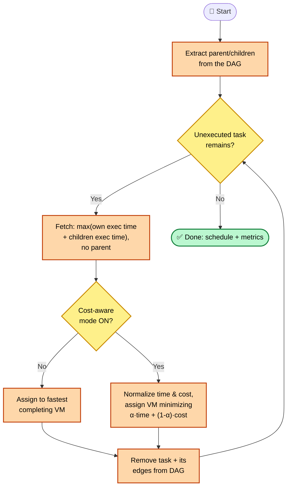
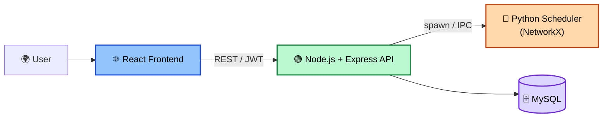

# 🚀 Infralytix — Guide Briefing & Study Handbook


> **Purpose:** One shared study doc for the whole team ahead of tomorrow's project explanation. Read top to bottom once, then use the collapsible sections as quick-reference during Q&A prep. Everyone should be able to give the same answers.

---

## 🎯 1. The 60-Second Pitch

> [!TIP]
> **Say this first, word for word if it helps:**
>
> *"Infralytix implements the Advanced Cost-Aware Max–Min scheduling algorithm from a 2024 Cluster Computing paper — it schedules dependent cloud workflow tasks onto virtual machines to minimize both makespan and cost. The paper's own contribution was purely algorithmic, tested via a standalone Python script. We built a full web platform around it: users upload a workflow as a DAG, configure a pool of VMs, and run the algorithm — plus three baseline algorithms for direct comparison — with a live α slider trading speed against cost. Everything paper-derived is kept explicitly separate from what we engineered on top, so the algorithm's fidelity to the published research is independently auditable."*

---

## 🧠 2. Full Walkthrough

### 2.1 The Problem
Cloud task scheduling assigns tasks to VMs to minimize makespan and cost. It's NP-hard — brute force is `O(m^n)` for n tasks, m VMs. Classical algorithms (FCFS, Round Robin, SJF, Max–Min, Min–Min) each optimize only part of the picture, and none handle **dependent** tasks with cost-awareness well.

### 2.2 The Research Foundation

> [!NOTE]
> **Cite this precisely:** Raeisi-Varzaneh, Dakkak, Fazea, Kaosar. *"Advanced cost-aware Max–Min workflow tasks allocation and scheduling in cloud computing systems."* Cluster Computing, 27, 13407–13419 (2024).
>
> Say: *"This paper is our algorithmic foundation. Task-selection and VM-selection logic come directly from Algorithm 2 — we did not modify it."*

### 2.3 The Algorithm — Plain Language

At each step, among tasks that are **ready to run** (no unfinished dependency), the algorithm picks the one whose **own size plus its children's total size** is largest — not just its own size. That one change is what lets independent parts of a workflow run concurrently instead of one-at-a-time (the flaw in the paper's own baseline, Workflow Max–Min).

Then, depending on a cost-management flag: the task goes to the **fastest** available VM, or to whichever VM minimizes a **weighted mix of normalized time and normalized cost** — that weight is α, tunable 0 (cheapest wins) → 1 (fastest wins).

### 2.4 Algorithm Flow (colorful reference diagram)



### 2.5 Architecture



**Tech stack, with the "why":**

| Tech | Why |
|---|---|
| ⚛️ React | Component-based UI for dashboards, sliders, live charts |
| 🟢 Node.js + Express | Lightweight REST layer, native JSON |
| 🐍 Python + NetworkX | Matches the paper's own reference implementation; free cycle detection & parent/child extraction |
| 🗄️ MySQL | Relational schema (users → workflows → tasks → dependencies → runs → assignments) is naturally foreign-key-heavy |
| 🔐 JWT + bcrypt | Stateless, scalable auth; adaptive password hashing |

---

## 🔢 3. Formulas — Verified Correct

> [!IMPORTANT]
> Every formula below is checked directly against the source paper and the SRS. Use exactly this notation — `VM_i` means "the i-th VM," `k` = number of VMs.

**Execution Time (ETC)** — how long a task takes on a given VM:
```
ETC(task, VM) = MI(task) / MIPS(VM)
```

**Makespan** — total time to finish the whole workflow (Eq. 1):
```
MS = max( MS(VM_1), MS(VM_2), ..., MS(VM_k) )
```

**Resource Utilization** — how busy VMs are, normalized (Eq. 2):
```
U = ( Σ MS(VM_i) for i=1..k / MS ) × (1/k)
```

**Idleness Cost** — money wasted on idle VM time (Eq. 3):
```
IC = Σ ( MS − MS(VM_i) ) × Cost(VM_i),  for i = 1..k
```

**Task selection rule** (the fetch step — this is the paper's key innovation):
```
selected_task = argmax over ready_tasks of
                 ( ExecTime(task) + Σ ExecTime(child) for child in children(task) )
```

**VM selection, cost-aware mode** (α ∈ [0, 1]):
```
selected_VM = argmin over VMs of
              ( α × NormalizedCompletionTime(VM) + (1 − α) × NormalizedCost(VM) )
```

<details>
<summary>🧮 <b>Worked mini-example (illustrative, not from the paper's published run)</b></summary>

Task `a` has 15,000 MI. VM1 runs at 5,000 MIPS.

```
ETC(a, VM1) = 15,000 / 5,000 = 3.0 seconds
```

If VM1 finishes at time 3.0s and is the last VM to finish (makespan = 3.0s), and VM1's cost is 15 units/1000 MI, its own idleness contribution is `(3.0 − 3.0) × 15 = 0` — it's not idle, since it *is* the makespan. A VM that finished earlier, say VM2 at 1.8s, contributes `(3.0 − 1.8) × Cost(VM2)` to the total idleness cost.

This is a simplified illustration to explain the mechanics — not a number to quote as coming from the paper.
</details>

---

## ❓ 4. Anticipated Q&A

<details>
<summary><b>🔬 On the algorithm</b></summary>

| Q | A |
|---|---|
| Why include children's execution time in task selection? | Selecting purely by a task's own size (older Workflow Max–Min) causes independent applications to run sequentially instead of concurrently. Including children's time captures downstream impact. |
| What happens at α = 0 or α = 1? | α=1 behaves identically to non-cost-aware mode (fastest VM always wins). α=0 sends everything to the cheapest VM regardless of speed — makespan spikes sharply as α→0. |
| What's the time complexity? | `O(mn²)`, same order as classical Max–Min — the algorithm doesn't exhaustively search every task/VM pair. The contribution is schedule *quality*, not speed. |
| What happens with a cyclic dependency? | Rejected at upload/parse time with the specific offending edge — never reaches the scheduler. |

</details>

<details>
<summary><b>⚙️ On tech/architecture</b></summary>

| Q | A |
|---|---|
| Why Python for the scheduler? | Matches the paper's own reference implementation language — keeps us close to fidelity. |
| Why not microservices? | Explicit project scope constraint (NFR-MAINT-2) — bounded academic project, not a system needing independent service scaling. |
| How does the refresh token work? | Short-lived access token + longer-lived refresh token; each refresh rotates the token (old one revoked, new one issued); reuse of a revoked token invalidates the whole token family. |

</details>

---

## 💡 5. The Novelty Question — Most Important

> [!CAUTION]
> **"What's actually new here — you're just implementing someone else's algorithm?"**
> This is the single most likely hard question. Answer it precisely — vague hand-waving here is worse than admitting a limit.

**The accurate answer:**

*"We are not claiming the scheduling algorithm as our contribution — Algorithm 2 (Advanced Cost-Aware Max–Min) belongs entirely to Raeisi-Varzaneh et al. (2024), and we state that explicitly every time we present it. Our contribution is engineering: taking an algorithm that existed only as a standalone, non-interactive Python script validated on synthetic task sets, and turning it into a reproducible, extensible decision-support platform, with four concrete additions the paper itself does not provide:*

1. ***Multi-algorithm, side-by-side comparison*** *— the paper compares algorithms only in its own offline experiments; we expose all four (Advanced, classical Max–Min, Min–Min, SJF) as live, user-triggered runs on the same uploaded workflow, with results rendered side-by-side, on metrics identical to the paper's own (makespan, resource utilization, idleness cost).*
2. ***Interactive cost/speed tuning*** *— the paper reports a fixed table of α values (Table 3) computed offline; we expose α as a live control that recomputes the schedule in real time, letting a user explore the tradeoff space interactively instead of reading a static table.*
3. ***A persisted, auditable run history*** *— every run (algorithm, α, VM configuration, resulting metrics) is stored and comparable across time, which the paper's script-based evaluation does not support at all.*
4. ***A general-purpose, user-facing workflow pipeline*** *— the paper's script assumes a pre-built task graph in code; our platform adds DAG upload, structural validation, and cycle detection so any user-supplied workflow can be scheduled, not just the paper's own hard-coded test case.*

*We're explicit about the boundary of this claim: it is a systems/application-level contribution — operationalizing and generalizing a validated algorithm into a usable, extensible, and auditable tool — not new algorithmic research, and not a claim that our platform improves the algorithm's makespan, cost, or complexity beyond what the paper already proves. If pushed for a research-track novelty claim beyond this, the accurate answer is that we don't have one yet; anything beyond this (multi-cloud cost comparison, explainability, budget-aware planning) is scoped future work, not a current claim. Holding this line — credit the algorithm to its authors, claim only the platform — is deliberate: it's the difference between a defensible contribution and an overstated one."*

---

## 🏆 6. Our Contributions

**From the paper (explicitly not ours):**
- Algorithm 2 (Advanced Cost-Aware Max–Min) — task-selection rule, VM-selection rule
- Eq. 1–3 — makespan, resource utilization, idleness cost formulas

**Our engineering contributions (built or in progress):**
1. Full-stack platform (React + Node/Express + Python/NetworkX + MySQL) operationalizing the algorithm end to end
2. DAG upload, parsing, and validation pipeline — structural checks, cycle detection, specific error reporting
3. Multi-algorithm comparative framework — Advanced + 3 baselines (classical Max–Min, Min–Min, SJF), live side-by-side comparison (FR-SCH-6, FR-DASH-4)
4. Interactive α control with real-time recomputation, replacing the paper's static offline sensitivity table
5. Persisted, queryable run history across workflows and configurations
6. Authentication & role-based access (User / Administrator / Evaluator) with refresh-token rotation (FR-AUTH-6, FR-AUTH-7)
7. PDF/CSV report export for completed runs
8. Independent reproduction of the paper's own worked example (5.9s makespan) as a correctness baseline for our implementation

**Planned / future work — not yet built, say so honestly if asked:**
- Multi-cloud cost comparison
- Explainability layer for VM-assignment decisions
- Budget-aware planning mode

---

## 📖 7. Glossary

<details>
<summary>Click to expand full glossary</summary>

| Term | Definition |
|---|---|
| DAG | Directed Acyclic Graph — nodes are tasks, edges are dependencies, no cycles |
| VM | Virtual Machine — simulated compute unit with a fixed MIPS rating |
| MIPS | Million Instructions Per Second — a VM's processing capacity |
| MI | Million Instructions — the workload size of a task |
| ETC | Expected Time to Compute = MI ÷ MIPS |
| Makespan | Total time to complete all tasks in a workflow |
| Idleness Cost | Cost incurred by faster/costlier VMs sitting idle |
| α (alpha) | Tunable factor [0,1] trading completion time against cost |
| DAX | Pegasus DAX XML format — standard scientific-workflow representation |
| JWT | JSON Web Token — stateless session authentication |

</details>

---

## 📚 8. Related Work

<details>
<summary>Click to expand</summary>

| Approach | Core Idea |
|---|---|
| Cui et al. — Markov-based | Multi-objective scheduling via queuing theory + GA |
| Liu et al. — Genetic Algorithm | Deadline-constrained scheduling, beats PSO on cost/deadlines |
| Sreenu & Sreelatha — W-Scheduler | Whale Optimization Algorithm |
| Kumar & Kousalya — Crow Search | Bio-inspired makespan minimization |
| Brar & Rao — Workflow Max–Min | **Direct baseline** — handles dependencies but runs applications sequentially, not concurrently |

**One-liner:** *"Most prior work is either metaheuristic without clean cost-awareness, or cost-aware without dependency handling. This paper — and our platform — combine dependency-aware scheduling with a tunable cost/speed tradeoff in one simple, non-metaheuristic algorithm."*

</details>

---

## 📑 9. References

1. Raeisi-Varzaneh, M., Dakkak, O., Fazea, Y., Kaosar, M.G. — *"Advanced cost-aware Max–Min workflow tasks allocation and scheduling in cloud computing systems."* Cluster Computing, 27, 13407–13419 (2024). https://doi.org/10.1007/s10586-024-04594-1 — **primary source paper**
2. Brar, S.S., Rao, S. — *"Optimizing workflow scheduling using max–min algorithm in cloud environment."* Int. J. Comput. Appl. 124(4), 44–49 (2015) — direct baseline (Workflow Max–Min)
3. Ming, G., Li, H. — *"An improved algorithm based on max–min for cloud task scheduling."* Recent Adv. Comput. Sci. Inf. Eng. 2, 217–223 (2012)
4. Pradhan, P., Behera, P.K., Ray, B. — *"Improved max-min algorithm for resource allocation in cloud computing."* 2020 Sixth Int. Conf. on Parallel, Distributed and Grid Computing (PDGC), pp. 22–24. IEEE (2020)
5. Cui, H., Li, Y., Liu, X., Ansari, N., Liu, Y. — *"Cloud service reliability modelling and optimal task scheduling."* IET Commun. 11(2), 161–167 (2017)
6. Liu, L., Zhang, M., Buyya, R., Fan, Q. — *"Deadline-constrained coevolutionary genetic algorithm for scientific workflow scheduling in cloud computing."* Concurr. Comput. Pract. Exp. 29(5), 3942 (2017)
7. Zhang, P., Zhou, M. — *"Dynamic cloud task scheduling based on a two-stage strategy."* IEEE Trans. Autom. Sci. Eng. 15(2), 772–783 (2017)
8. Sreenu, K., Sreelatha, M. — *"W-scheduler: whale optimization for task scheduling in cloud computing."* Cluster Comput. 22, 1087–1098 (2019)
9. Prasanna Kumar, K., Kousalya, K. — *"Amelioration of task scheduling in cloud computing using crow search algorithm."* Neural Comput. Appl. 32(10), 5901–5907 (2020)
10. Topcuoglu, H., Hariri, S., Wu, M.Y. — *"Performance-effective and low-complexity task scheduling for heterogeneous computing."* IEEE Trans. Parallel Distrib. Syst. 13(3), 260–274 (2002) — foundational HEFT list-scheduling algorithm, widely cited baseline for DAG scheduling
11. Rodriguez, M.A., Buyya, R. — *"Deadline based resource provisioning and scheduling algorithm for scientific workflows on clouds."* IEEE Trans. Cloud Comput. 2(2), 222–235 (2014) — deadline- and cost-aware provisioning for scientific workflows
12. Arabnejad, H., Barbosa, J.G. — *"List scheduling algorithm for heterogeneous systems by an optimistic cost table."* IEEE Trans. Parallel Distrib. Syst. 25(3), 682–694 (2014) — PEFT algorithm, relevant point of comparison for list-scheduling heuristics

---

## 📝 10. What a Conference Paper Needs

- **Abstract** — problem, approach, key result, ~150 words
- **Related Work** — §8 above is your starting point, §9 gives you the citations
- **Methodology** — algorithm (§2.3) + platform architecture (§2.5)
- **Results** — current weak point; need real run data, not just the paper's own numbers
- **Conclusion / Future Work** — the CCOA angle belongs here, honestly, as future work

---

## ✅ 11. Pre-Meeting Checklist

- [ ] Can everyone say the 60-second pitch (§1) without notes?
- [ ] Can everyone write Eq. 1–3 from memory?
- [ ] Has the team rehearsed the novelty answer (§5) word for word?
- [ ] Can everyone recite 2–3 of the concrete contributions (§6)?
- [ ] Can everyone name 2–3 related-work approaches (§8) with citations (§9)?

---

## 🧾 12. One-Page Cheat Sheet

| Fact | Value |
|---|---|
| 📄 Paper | Raeisi-Varzaneh et al., Cluster Computing, 2024 |
| 🏷️ Algorithm | Advanced Cost-Aware Max–Min |
| 🔢 Task selection | max(own exec time + children's exec time), ready tasks only |
| 🔢 VM selection (cost-aware) | minimize α×NormalizedTime + (1−α)×NormalizedCost |
| ⏱️ Complexity | O(mn²) — same order as classical Max–Min |
| 🖥️ Paper's test setup | 3 VMs, 5000/3000/2000 MIPS, costs 15/10/5 per 1000 MI |
| 📈 Paper's headline results | waiting time 5.27s→4.67s · utility +34% · idleness cost −92% |
| 🎯 Worked-example makespan | 5.9s |
| ⚖️ Your 4 algorithms | Advanced, classical Max–Min, Min–Min, SJF |
| 🛠️ Stack | React · Node+Express · Python+NetworkX · MySQL · JWT+bcrypt |
| 🏗️ Architecture | Layered, single logical backend (not microservices) |
| 💡 Novelty | Platformization + multi-algorithm comparison + live α control (§5, §6) |

---

<p align="center">
<sub>Built for team study ahead of guide review. Keep this file updated as the project evolves — it's the shared source of truth.</sub>
</p>
